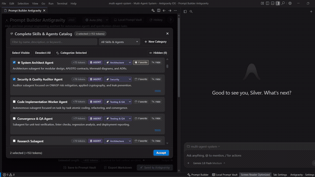
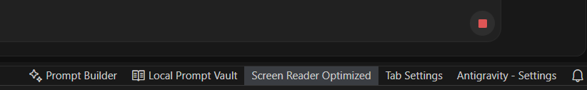

# Prompt Builder Antigravity ✨

**Prompt Builder Antigravity** convierte una idea o un fragmento de código en un prompt que un agente puede ejecutar sin adivinar: rol, objetivo, criterios de aceptación y restricciones, con los comandos nativos del IDE a un clic.

Funciona en **Antigravity IDE** y en **VS Code 1.105+**. Es **gratis**, no necesita conexión y **no envía datos a ningún servidor**.

*Extensión independiente. No está afiliada ni respaldada por Google.*

---

  

---

## 📍 ¿Dónde encontrar y abrir el Asistente? (Acceso Rápido)

Puedes abrir el asistente con un solo clic desde los botones situados en la **barra de estado inferior** de tu editor:

1. **`✨ Prompt Builder`**: Abre la ventana completa del generador de prompts avanzados.
2. **`📖 Local Prompt Vault`**: Abre directamente la Bóveda Local de Prompts guardados (Global y Workspace).

### Otras formas de acceso inmediato:
- **Atajo global de teclado:** `Ctrl + Alt + P` (o `Cmd + Alt + P` en macOS).
- **Menú contextual del editor:** Clic derecho sobre cualquier archivo -> `Prompt Builder Antigravity: Abrir Generador de Prompts`.
- **Panel de Chat de Antigravity:** Icono de destello `$(sparkle)` en la cabecera y barra de entrada del chat.

---

## 🆕 Novedades de la Versión 1.0.3

- **Diseño Nativo y Tipografía del IDE:** Adopción estricta de la tipografía del sistema (`var(--vscode-font-family)`) y reemplazo total de emojis por Codicons vectoriales SVG de VS Code, garantizando nitidez perfecta en Windows, macOS y Linux.
- **Jerarquía Visual y Sección HERO:** Destaque visual en el bloque de Rol y Objetivo, junto con colapsables secundarios para criterios de calidad y vista previa en vivo, optimizando el espacio en resoluciones compactas (1366×768).
- **Barra de Acciones Fija y Botón Limpiar Formulario:** Acceso constante al botón "Send to Antigravity", contador de tokens en tiempo real, bloqueo reactivo ante campos de objetivo vacíos y nuevo control para restablecer el formulario a sus valores iniciales.

---

## 🆕 Novedades de la Versión 1.0.2

- **Reactivación Total de la Interfaz:** Corrección crítica de sintaxis en el cliente Webview que ocasionaba que los botones, selectores de roles, catálogo de skills y modales se mostraran estáticos o no respondieran al clic.
- **Compatibilidad Estricta CSP (Nonce Dinámico):** Implementación de tokens `nonce` criptográficos en la directiva Content Security Policy (`script-src 'nonce-...'`), asegurando la ejecución permitida bajo el sandbox estricto de Antigravity IDE y VS Code.
- **Indicador Visual de Acceso:** Documentación visual en la barra inferior para una rápida localización dentro del entorno de trabajo.

---

## 🚀 Características Principales

### 1. ⚡ Comandos Slash Nativos de Antigravity
Integra en una sola fila y con tooltips explicativos los comandos directos del motor de Antigravity:
- **`/plan`**: Exige una planificación meticulosa, análisis arquitectónico y roadmap antes de modificar código.
- **`/schedule`**: Programa una ejecución con temporizador de una sola vez o cron recurrente en segundo plano.
- **`/goal`**: Activa el modo autónomo continuo; el agente itera y no se detiene hasta cumplir el objetivo.
- **`/grill-me`**: Inicia una entrevista interactiva donde el modelo te hace preguntas para alinear decisiones clave de diseño.
- **`/learn`**: Ordena al agente guardar y persistir los patrones aprendidos o correcciones para futuros prompts.

### 2. 👤 Catálogo de 50 Roles y Especialidades (+ Botón Dinámico)
- **Por defecto neutral ("Sin Rol / Especialidad")**: Para consultas directas sin sesgo.
- **Principales Roles de Software (20 perfiles)**:
  - Arquitecto de Software FullStack, Desarrollador FrontEnd, Diseñador UX/UI, Desarrollador Backend, Auditor de Seguridad OWASP, Ingeniero DevOps, DBA, QA Automatizado, SRE, Ingeniero de ML/AI, Desarrollador Móvil, Ingeniero de Plataforma, etc.
- **Especialidades y Roles Contextuales (30 perfiles)**:
  - Especialista en Refactorización, Migración Legacy, Agentes de IA, RAG y Bases Vectoriales, Criptografía JWT, Webhooks, Accesibilidad WCAG 2.1, Core Web Vitals, Redis, Docker, SEO Técnico, etc.
- **Botón `+`**: Permite escribir y agregar roles personalizados al listado al instante.

### 3. 🎯 Objetivo con Requisito Obligatorio
- Área de texto amplia (5 filas) para redactar el objetivo o problema.
- **Check "Requisito Obligatorio"**: Al marcarlo, convierte la instrucción en un bloque mandatorio formal `> [!IMPORTANT]`, asegurando máxima prioridad en la respuesta del agente.

### 4. 📁 Detección Automática de Contexto y Código
- Detecta y precarga automáticamente el código que tengas seleccionado en el editor al abrir el generador.
- Identifica el nombre del archivo activo (`.ts`, `.php`, `.py`, `.json`, etc.) y lo incluye formateado en bloques de código limpios.

### 5. ✅ Criterios de Aceptación
- Sección plegable para establecer condiciones verificables que la solución debe cumplir antes de darse por completada (pruebas unitarias exitosas, umbrales de latencia, compatibilidad estricta).

### 6. ⚡ Directivas y Sugerencias de Ejecución
- **3 Sugerencias de mejora** (Activa por defecto): Solicita exactamente 3 recomendaciones concretas al terminar la tarea.
- **Propuesta alternativa de mayor alcance**: Pide al modelo una visión superadora de arquitectura.
- **Cero Placeholders**: Prohíbe tajantemente comentarios tipo `// TODO` o código truncado.
- **Seguridad OWASP**: Exige sanitización estricta de entradas y buenas prácticas de seguridad.

### 7. 📑 Formatos de Salida Rigurosos
- **Código completo y modular listo para producción sin placeholders**.
- **Explicación paso a paso con bloques de diff**.
- **Análisis de arquitectura y plan de acción estructurado**.
- **Revisión crítica, hallazgos y correcciones**.

### 8. 🧠 Catálogo y Categorización Inteligente de Habilidades (Skills) y Agentes
Prompt Builder Antigravity actúa como centro de control para tus herramientas de IA:
- **Detección Automática Multi-Entorno:** Escanea dinámicamente tu espacio de trabajo y directorios globales (`.gemini/skills`, `.agents/skills`, `.claude/skills`).
- **Clasificación por Tipos Nativos:**
  - 🤖 **AGENTE:** Subagentes autónomos (Product Owner, Arquitecto de Software, Auditor de Seguridad, QA & Convergencia).
  - 🧠 **SKILL:** Habilidades operativas especializadas.
  - 📋 **DIRECTIVA:** Reglas de gobernanza, estándares y directivas de desarrollo.
  - ⚙️ **PROCESO:** Flujos de trabajo, pipelines, compilación, release y migraciones.
- **Categorización Flexible:**
  - **Individual:** Menú desplegable por ítem para asignar o crear nuevas categorías al vuelo.
  - **En Bloque (Bulk Categorize):** Selección múltiple de habilidades con casillas de verificación para categorizar decenas de skills en un solo paso.
- **Filtros Avanzados:** Filtrado instantáneo por texto, por favoritos (⭐), por activos (✅), por elementos ocultos (👁️) o por categoría personalizada.
- **Inyección Estructurada:** Inyecta solo las habilidades que actives, con el costo en tokens visible antes de enviar.

### 9. 📚 Lista Prompt Local (Vault Storage)
- **Persistencia Dual:** Almacenamiento seguro en formato JSON con dos ámbitos de alcance:
  - **Global (`~/.antigravity/prompt_vault.json`):** Disponible en cualquier proyecto o ventana del IDE.
  - **Workspace (`.antigravity/prompt_vault.json`):** Específico del repositorio actual, compartible con tu equipo de desarrollo vía control de versiones.
- **Metadatos Completos:** Guarda título, ámbito, categoría (Arquitectura, Seguridad, Refactor, Pruebas, DevOps, General), conteo estimado de tokens y estado exacto del formulario.
- **Recuperación con un Clic:** Botón "Cargar" para restaurar al instante el prompt, roles, habilidades y restricciones exactas.
- **Buscador en Tiempo Real y Favoritos:** Localiza rápidamente cualquier prompt por título o palabras clave.

### 10. 🌐 Soporte Multi-idioma Nativo (i18n & l10n)
- **Autodetección:** Detecta automáticamente el idioma de la instalación de tu editor (`vscode.env.language`).
- **7 Idiomas Soportados:** Español (`es`), Inglés (`en`), Portugués (`pt-br`), Francés (`fr`), Alemán (`de`), Chino Simplificado (`zh-cn`) y Japonés (`ja`).
- **Selector Manual:** Selector en la cabecera para alternar entre idiomas en caliente con actualización inmediata de la interfaz, botones y notificaciones toast.

### 11. ⚡ Plantillas Rápidas (Presets)
- Tarjeta plegable con configuraciones listas para usar en un clic:
  - `⚡ Nueva Feature de Software`
  - `🛡️ Auditoría de Seguridad OWASP`
  - `🚀 Refactorización y Rendimiento`
  - `🗄️ Esquema y Modelado de BD`

### 12. 🕒 Historial Persistente
- Guarda automáticamente en almacenamiento global tus últimos 12 prompts generados.
- Permite reutilizar o inspeccionar prompts previos con fecha y hora.

### 13. 📄 Exportación a Markdown y Acciones Rápidas
- **📄 Exportar .md**: Abre el prompt en un nuevo documento Markdown editable en una columna lateral del editor.
- **📋 Copiar al Portapapeles**: Copiado instantáneo con indicador visual.
- **🚀 Enviar a Antigravity**: Copia el prompt, guarda en historial y abre automáticamente la ventana de chat del IDE.

---

## ⌨️ Atajos de Teclado y Puntos de Acceso

- **Atajo global:** `Ctrl + Alt + P` (o `Cmd + Alt + P` en macOS).
- **Barra de estado:** Clic en `$(sparkle) Prompt Builder` (lado inferior derecho).
- **Menú contextual del editor:** Clic derecho sobre cualquier archivo -> `Prompt Builder Antigravity: Abrir Generador de Prompts`.
- **Panel de Chat:** Icono `$(sparkle)` en el encabezado y en la barra de entrada del chat.

---

## 🛠️ Tecnologías y Requisitos

- Compatible con **Antigravity IDE** y VS Code (motores `^1.105.0` y superiores).
- Totalmente autónomo: no requiere dependencias externas ni conexión a internet para renderizar.
- Persistencia local mediante la API de VS Code (`globalState` y `vscode.setState`).

---

Desarrollado por AlaxuxSoft. Contacto: [alaxuxsoft.com](https://alaxuxsoft.com) | [alaxuxsoft@gmail.com](mailto:alaxuxsoft@gmail.com)
